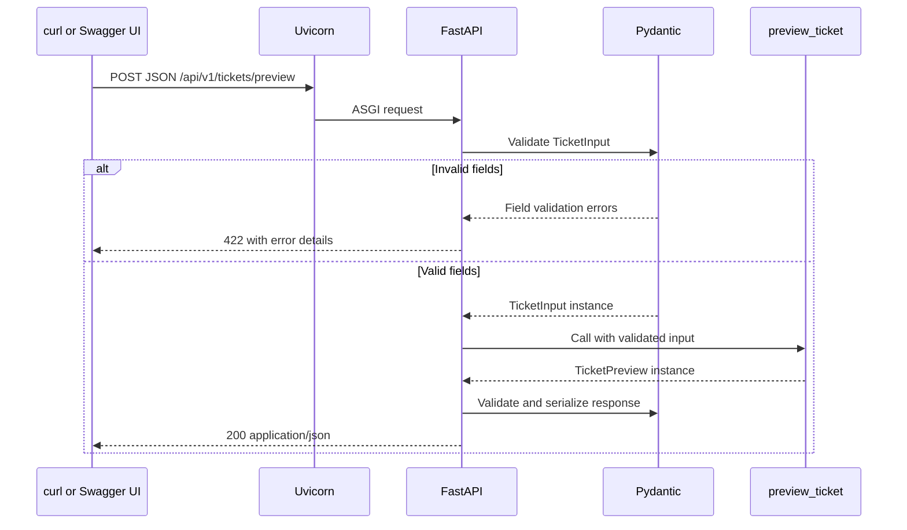

# Lesson 1: Your First Reliable HTTP Contract

## Goal

By the end, explain how JSON becomes a validated Python object and then a JSON
response. Run a successful request, trigger a validation failure, and read the
test that proves each behavior.

Start the server using the commands in the [README](../README.md).
Trace from the [app factory](../src/backendfastapi/main.py) to the
[ticket endpoint](../src/backendfastapi/api/v1/endpoints/tickets.py) and
[schemas](../src/backendfastapi/schemas/tickets.py).

## 1. What FastAPI Actually Does

An API is a contract between a caller and a service. HTTP supplies the request
method, path, headers, body, and response status. JSON is a common body format;
it is not the HTTP protocol itself.

- **Uvicorn** listens for HTTP connections and runs the ASGI application.
- **ASGI** is the interface between the server and an async-capable Python app.
- **FastAPI** matches routes, resolves dependencies, coordinates validation, and
  generates an OpenAPI description of the contract.
- **Pydantic** parses and validates data using models and constraints.
- **Your function** implements the application's behavior.

FastAPI builds on Starlette for the underlying web functionality. It does not
automatically provide a database, identity provider, durable queue, or AI agent.

## 2. Read the Small Application

### Application object

```python
app = FastAPI(title="Support Agent API", version="0.1.0")
```

`create_app` builds the ASGI application, registers routers, and returns it.
The module exports the created app as `app`. In the startup command,
`backendfastapi.main:app` means "import the module `backendfastapi.main` and
use its `app` object." `uv sync` installs the local package so the `src/`
layout is importable without manually modifying `PYTHONPATH`.

### Input contract

```python
class TicketInput(BaseModel):
    model_config = ConfigDict(str_strip_whitespace=True, extra="forbid")

    subject: str = Field(min_length=1, max_length=120)
    message: str = Field(min_length=10, max_length=4000)
    customer_reference: str | None = Field(default=None, min_length=1, max_length=64)
```

`BaseModel` gives these type hints runtime meaning. A plain Python annotation
alone does not enforce runtime validation. `subject` and `message` are required;
`customer_reference` is optional because it defaults to `None`. String
whitespace is stripped before length validation; a subject containing only
spaces is therefore invalid. Unknown fields are rejected instead of silently
ignored. The model is defined in `schemas/tickets.py`.

These are character-length constraints, not network-body or token limits.
Validation also does not prove a request is authorized or safe to send to an
LLM. Those are separate checks we add later.

### Route and output contract

```python
@router.post("/preview", response_model=TicketPreview)
async def preview_ticket_endpoint(ticket: TicketInput) -> TicketPreview:
    return preview_ticket(ticket)
```

The router is mounted under `/api/v1`, so this decorator registers
`POST /api/v1/tickets/preview`. The `ticket: TicketInput` parameter tells
FastAPI to obtain and validate a JSON request body. If validation fails, the
handler does not run. The endpoint delegates the preview operation to the
service; `response_model` defines the public output shape and validates/filters
the response. `Literal["validated"]` restricts the status to that one value;
it is not an arbitrary string.

We use **200 OK**, not **201 Created**, because previewing does not create a
stored ticket. The response does not imply an agent has started.

## 3. Trace the Request



Response validation failures indicate a server-side contract bug. They are not
the same as client-input errors and should not be exposed as a successful 200.

## 4. Try It Yourself

Open http://127.0.0.1:8000/docs, expand the POST operation, select **Try it out**,
and send:

```json
{
  "subject": "  Login issue  ",
  "message": "I cannot log in today."
}
```

Expect HTTP 200, a trimmed subject, and `status` equal to `validated`.
Then send:

```json
{"subject":"Login issue","message":"short"}
```

Expect HTTP 422. In the JSON error details, `loc` identifies `body` and `message`.
Also try removing `message`, adding `admin: true`, and sending a whitespace-only
subject. All should be rejected. Our tests verify those cases.

Useful status codes, with precise meanings:

| Code | Meaning in this project or future lessons                                    |
| ---- | ---------------------------------------------------------------------------- |
| 200  | Successful preview or read                                                   |
| 201  | A resource has actually been created                                         |
| 202  | Work accepted; not proof it completed successfully                           |
| 401  | Missing or invalid authentication                                            |
| 403  | Caller is authenticated but not allowed to act                               |
| 404  | Route/resource not found, sometimes also used to hide inaccessible resources |
| 422  | Parsed request does not satisfy the input contract                           |
| 429  | Request rate or quota exceeded                                               |
| 500  | Unexpected server failure                                                    |
| 503  | Service temporarily unable to handle the request                             |

## 5. What Does async Mean?

`async def` creates a coroutine function. When it awaits an asynchronous I/O
operation, the event loop can run other tasks while that operation waits.
It does not make CPU work faster or turn blocking libraries into async ones.

Our preview does no I/O, so there is nothing to `await` yet. A normal `def`
endpoint would also work. We will introduce genuine async network I/O later.

Do not use blocking HTTP clients, `time.sleep()`, or heavy CPU work directly
inside an async endpoint. Use async libraries for I/O; use appropriate thread
offloading for blocking I/O and worker processes for substantial CPU work.
Thread offloading still needs concurrency limits.

For an agent, model calls and database operations often spend time waiting on
networks. Async can improve concurrency, but a queue and durable worker solve
a different problem: surviving crashes and handling long-running work.

## 6. Tests Are Executable Theory

Read [the tests](../tests/test_main.py), then run:

```bash
uv run pytest tests/test_main.py -q
uv run ruff check .
```

`TestClient` calls the ASGI app in-process; it does not need a server listening
on a TCP port. The fixture gives each test a client and manages app lifespan.
Parameterized tests exercise multiple bad inputs using one test function.

The tests cover health, normalized successful input, seven invalid-input cases,
and the generated OpenAPI contract. They do not yet test real network behavior,
authentication, model quality, performance, or deployment readiness.

`/health/live` means the process can answer this request. It does not check a
database or model provider. Readiness will become a separate endpoint when
the application gains dependencies.

## 7. Review Before Lesson 2

The ticket contract now includes an optional `customer_reference`:

1. Default it to `None`, so the existing requests still work.
2. When present, require 1 to 64 characters after whitespace trimming.
3. Return the value in the preview response.
4. Test omission, a valid value, and an invalid value.
5. The existing tests verify omission, normalization, invalid values, and the
    response field.

Hint: `str | None` describes a nullable value. It only becomes optional to
provide when you also give it a default, such as `= None`.

Explain these before moving on:

- Why is this endpoint a preview rather than a ticket-creation endpoint?
- Which component rejects a short message, and does the handler run?
- What is the difference between a type annotation and runtime validation?
- Why does `async def` not make a blocking model client nonblocking?
- Why is input validation not a substitute for tool authorization?

Next: use dependency injection to replace the ticket service with a fake in a
test, then add settings and lifespan-managed resources as the app gains them.

## References

- [FastAPI tutorial](https://fastapi.tiangolo.com/tutorial/)
- [FastAPI concurrency and async](https://fastapi.tiangolo.com/async/)
- [Pydantic models](https://docs.pydantic.dev/latest/concepts/models/)
- [Uvicorn settings](https://www.uvicorn.org/settings/)