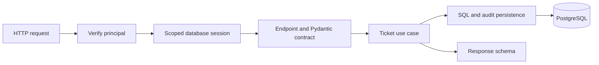
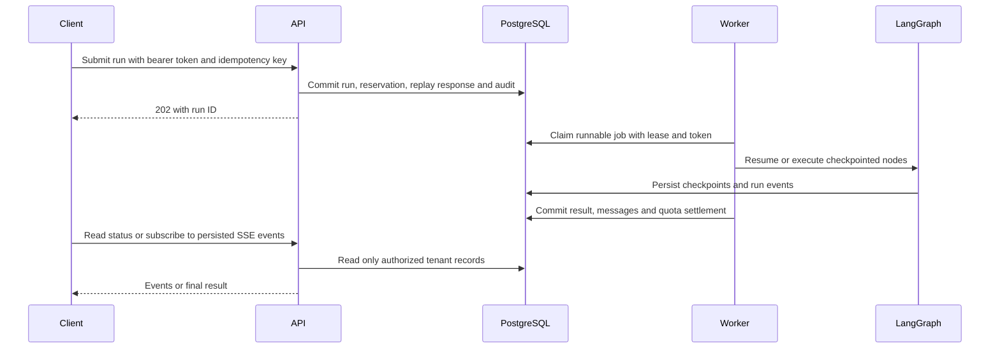

# From FastAPI Basics to Production Agent Services

This is historical learning material for the original tutorial milestones, not
the current feature inventory. For the running application, start with the root
[README](../README.md) and [tenant agent platform guide](agent-platform.md).
The numbered lessons in this folder remain useful explanations of the basics.

## The Project

We are building a support-agent backend that will accept a ticket, retrieve
relevant knowledge, use approved tools, draft an answer with sources, and ask
# Learn This Project by Following Its Behavior

Do not read every file from top to bottom. Follow one request, predict what it
will do, run its test, and explain the result. This guide describes the current
implementation; use [the platform guide](agent-platform.md) for setup and API details.
Search the source for `Learn:` to find the in-code study notes.

## Start Today

From the repository root:

```bash
uv sync --locked
uv run pytest tests/test_main.py -k preview -q
```

These tests use a temporary SQLite database, not your application database. Routine
workflow tests use fake model responses, so provider credentials and paid calls are
not needed. Keep real secrets out of experiments, screenshots and debugger watches.

Open these files in order:

1. [Ticket schemas](../src/backendfastapi/schemas/tickets.py): what input is allowed?
2. [Ticket endpoints](../src/backendfastapi/api/v1/endpoints/tickets.py): which function handles the request?
3. [Ticket service](../src/backendfastapi/services/tickets.py): what use case is performed?
4. [Ticket repository](../src/backendfastapi/repositories/tickets.py): what SQL runs, and when is it committed?
5. [Support models](../src/backendfastapi/db/models/support.py): what is actually stored?
6. [Ticket tests](../tests/test_main.py): how is the behavior demonstrated?

Your first exercise: predict the response to a whitespace-only subject and an
unexpected `admin` field, then find the tests proving your prediction. Next,
explain why the preview route does not need to insert a row.

## Repeatable Analysis Method

For each feature, write a small note using this template:

```text
Feature / endpoint:
Input and validation:
Identity / role / tenant checks:
Function call chain:
Database reads and writes:
Commit or rollback boundary:
External calls and limits:
Failure or concurrency case:
Test that proves the behavior:
Remaining assumptions:
```

Use VS Code's Go to Definition and Find All References to follow a symbol.
Read the schema and a nearby test before following every helper. Distinguish
what the code guarantees from what a comment or folder name merely suggests.

For one study session: read a slice, make a prediction, run its focused test,
try a small change in a local exercise, then restore only your own experiment.
Never disable authorization in a shared or deployed environment to learn a flow.

## Reading Plan

Work through these in order. Move on when you can explain the exit question,
not when you have merely opened every file.

| Topic | Read | Learn / Exit Question | Test |
| --- | --- | --- | --- |
| 1. HTTP contracts | [schemas](../src/backendfastapi/schemas/tickets.py), [endpoints](../src/backendfastapi/api/v1/endpoints/tickets.py) | Types, enums, Pydantic validation, status codes. Why is invalid input `422`? | [test_main.py](../tests/test_main.py) |
| 2. App composition | [main.py](../src/backendfastapi/main.py), [router](../src/backendfastapi/api/v1/router.py), [dependencies](../src/backendfastapi/api/deps.py) | Factory, lifespan, dependency injection. What runs once per process versus once per request? | [test_security.py](../tests/test_security.py) |
| 3. Persistence | [service](../src/backendfastapi/services/tickets.py), [repository](../src/backendfastapi/repositories/tickets.py), [models](../src/backendfastapi/db/models/support.py) | Async sessions, flush/commit, cursor pagination, optimistic concurrency. Why does a stale update fail? | [test_main.py](../tests/test_main.py) |
| 4. Identity | [auth routes](../src/backendfastapi/api/v1/endpoints/auth.py), [identity](../src/backendfastapi/core/identity.py) | Password hashes, signed tokens, refresh rotation, current roles. Why does logout invalidate a still-unexpired access token? | [test_identity.py](../tests/test_identity.py) |
| 5. Authorization | [dependencies](../src/backendfastapi/api/deps.py), [tenant hooks](../src/backendfastapi/db/tenancy.py) | Authenticated tenant context, query filters, write guards. Why is a client-supplied tenant ID unsafe? | [test_identity.py](../tests/test_identity.py), [test_platform.py](../tests/test_platform.py) |
| 6. Shared controls | [controls](../src/backendfastapi/services/controls.py), [control models](../src/backendfastapi/db/models/controls.py) | Atomic upserts, fixed windows, reservations, replay hashes. How do replicas coordinate without process-local counters? | [test_controls.py](../tests/test_controls.py) |
| 7. Job acceptance | [run routes](../src/backendfastapi/api/v1/endpoints/runs.py), [run service](../src/backendfastapi/services/runs.py) | `202` versus completion, idempotency and approval. Which records must commit together? | [test_runs.py](../tests/test_runs.py) |
| 8. Agent execution | [graph](../src/backendfastapi/agents/durable.py), [worker](../src/backendfastapi/worker.py) | State updates, token bounds, leases, checkpoints and fencing. What may repeat after a crash? | [test_runs.py](../tests/test_runs.py) |
| 9. Retrieval and safety | [retrieval](../src/backendfastapi/services/knowledge.py), [platform routes](../src/backendfastapi/api/v1/endpoints/platform.py), worker tool callback | Tenant-filtered lexical RAG, immutable prompts, reviewed tools, feedback. Why is a prompt not an authorization boundary? | [test_platform.py](../tests/test_platform.py) |
| 10. Observability | [tracing](../src/backendfastapi/core/tracing.py), [logging](../src/backendfastapi/core/logging.py), [metrics](../src/backendfastapi/core/observability.py) | Logs versus metrics versus traces, propagation, cardinality and redaction. What must never be exported? | [test_tracing.py](../tests/test_tracing.py), [test_security.py](../tests/test_security.py) |
| 11. Deployment | [Dockerfile](../Dockerfile), [Compose](../compose.yaml), [migrations](../migrations/README.md), [CI](../.github/workflows/ci.yaml) | Images, runtime users, startup jobs, health, locking and releases. Why not migrate in every API worker? | [test_postgres.py](../tests/test_postgres.py) |

## Draw These Flows

### A Ticket Request



The diagram shows responsibilities, not a promise of an exact ordering between
independent FastAPI validation and dependency steps. Locate `commit` in the
actual path: idempotent ticket creation intentionally defers the repository commit.

### A Durable Run



PostgreSQL is the queue here: there is no separate Redis broker or outbox relay.
The workflow is bounded retrieval -> generation -> optional reviewed tool, not an
unrestricted autonomous agent. A completed checkpoint avoids repeating that node;
an interrupted, uncheckpointed provider call may repeat and incur another charge.

## Exercises With Existing Evidence

1. **Validation:** run the preview tests. Add one local boundary-case test, such
    as a maximum-length subject. Explain Pydantic schemas versus SQLAlchemy models.
2. **Transactions:** debug ticket creation. Observe the ID after `flush`, then
    identify the commit that also makes the audit/replay record durable.
3. **Concurrency:** run `test_ticket_status_update_rejects_stale_version`. Predict
    why changing the version check into a separate SELECT would introduce a race.
4. **Isolation:** run `test_tenant_isolation_and_roles`. Trace the second tenant's
    request into `session.info` and `with_loader_criteria`; explain the `404`.
5. **Idempotency:** run `test_run_idempotency_cancellation_and_budget`. Explain
    same key/same payload, same key/different payload, and a brand-new key.
6. **Recovery:** run `test_checkpoint_recovery_does_not_regenerate_completed_answer`.
    Draw the simulated crash point. Explain the model call count and remaining
    limitations if the crash happened before generation's checkpoint.
7. **Cancellation:** run `test_running_generation_can_be_cancelled`. Explain why
    unsubscribing from SSE is not cancellation and why a provider bill may remain.
8. **Approvals:** run `test_tool_requires_separate_approver_and_tenant_grant`.
    Identify the checks at submission, approval and actual execution.
9. **Tracing:** run `test_traces_never_capture_bodies_keys_or_raw_urls`. Inspect
    the in-memory exporter, not real secrets. Explain a request ID versus a trace ID.
10. **Evaluation:** read the required/forbidden phrase checks. Propose an answer
     that passes them but is factually wrong: what additional evaluation is needed?

Example focused commands:

```bash
uv run pytest tests/test_main.py -k stale_version -q
uv run pytest tests/test_identity.py -q
uv run pytest tests/test_controls.py -q
uv run pytest tests/test_runs.py -k checkpoint_recovery -q
uv run pytest tests/test_tracing.py -q
```

## Debug in VS Code

Configure test discovery for pytest using the project's uv virtual environment.
Set a breakpoint at `create_ticket_endpoint`, choose **Debug Test** for
`test_create_and_read_ticket`, and step into the service/repository. Then try
`test_run_idempotency_cancellation_and_budget` with a breakpoint in `submit_run`.

Watch validated input, the principal's role/tenant, `session.info`, record IDs,
status/version and the call stack. Do not inspect/export passwords, JWTs, API
keys, real messages or connection URLs. Step through tests before debugging live
workers: tests make failure and timing assumptions easier to reproduce.

## Integration and Production Limits

SQLite/fake-model tests teach contracts and flow, not real PostgreSQL locks or
model answer quality. [test_postgres.py](../tests/test_postgres.py) uses an
explicit **disposable** database and runs schema downgrades. Never point it at
application or production data. See the setup instructions in
[README.md](../README.md) before running that test.

Similarly, an in-memory trace exporter proves instrumentation assertions, not a
live collector's availability. A short k6 test is not a capacity study. Lexical
retrieval is not vector search. A human-approved local tool is not a sandbox for
arbitrary code. Learn the implemented boundary before adding another library.

## Explain It Back

You understand a feature when you can:

- Draw its flow without reopening the code.
- Name the input contract, authorization rule and transaction owner.
- Predict one failure, one concurrency issue and the relevant test.
- State what the implementation does not guarantee.
- Make one small change with a focused regression test.

For fundamentals, use the companion lessons on
[FastAPI](01-fastapi-foundations.md), [Pydantic](02-pydantic-models.md) and
[asyncio](03-asyncio-and-concurrency.md). For running/deploying the full service,
use [the platform guide](agent-platform.md) and [operations guide](production.md).
Database fundamentals ke liye [SQLAlchemy aur Alembic revision guide](sqlalchemy-alembic-revision-hinglish.html) kholo.